# How Good Is Your Spec? Scoring It the Way a Coding Agent Reads It

*ZeeSpec now has an EPIC Score tab and a `spec score` command. They grade a spec against 40 published practices, entirely in your browser or terminal.*

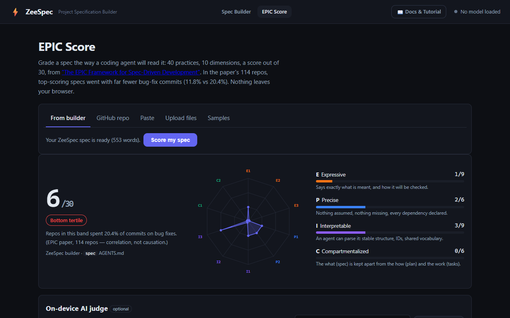

## The problem

Spec-driven development has become the normal way to work with coding agents. You write a spec, often with a plan and a task list, and the agent builds from it. Tools such as Spec Kit, Kiro and ZeeSpec help you write those files.

Writing a spec doesn't make it a good one, though. A spec can read well to a person and still leave an agent guessing:

- "It should be fast" gives the agent no number to aim for.
- "Admins can manage users, reservations etc." doesn't say what "etc." covers.
- A requirement with no ID can't be traced to the task that builds it or the test that checks it.
- If the tech stack is written into the requirements, the agent can't tell what is a requirement and what is a design choice.

Each gap becomes a guess, and some guesses become bugs. The research backs this up. *The EPIC Framework for Spec-Driven Development* (arXiv:2610.07534) scored the specs, plans and task files of 114 open-source spec-driven repos against the ISO/IEC/IEEE 29148 requirements standard. The top-scoring third of the repos spent **11.8%** of their commits on bug fixes. The bottom third spent **20.4%**. That is a correlation, not proof, but it is a large gap.

The paper groups 40 practices into 10 quality dimensions under four headings:

| | Heading | What it asks |
|---|---|---|
| **E** | Expressive | Does the spec say exactly what is meant, and how it will be checked? |
| **P** | Precise | Is anything assumed or missing? Is every dependency declared? |
| **I** | Interpretable | Can an agent parse it, with stable structure, IDs and shared vocabulary? |
| **C** | Compartmentalized | Is the *what* (spec) kept apart from the *how* (plan) and the *work* (tasks)? |

Each dimension is scored 0–3, so the total is out of 30. The paper's bands are **bottom (18 or less)**, **middle (19–22)** and **top (23 or more)**.

The paper gives a standard but no tool. Checking 40 practices by hand on every spec isn't practical.

## The solution: score the spec the way you build it

ZeeSpec already helps you *write* a spec through 60 questions across six dimensions (What, Where, When, Who, Why, How). The new **EPIC Score** tab *grades* the spec, so the two steps sit together on one page: build, score, fix, score again.

### 1. Build a spec as usual

Open the ZeeSpec app. The header now has two tabs: **Spec Builder** and **EPIC Score**.

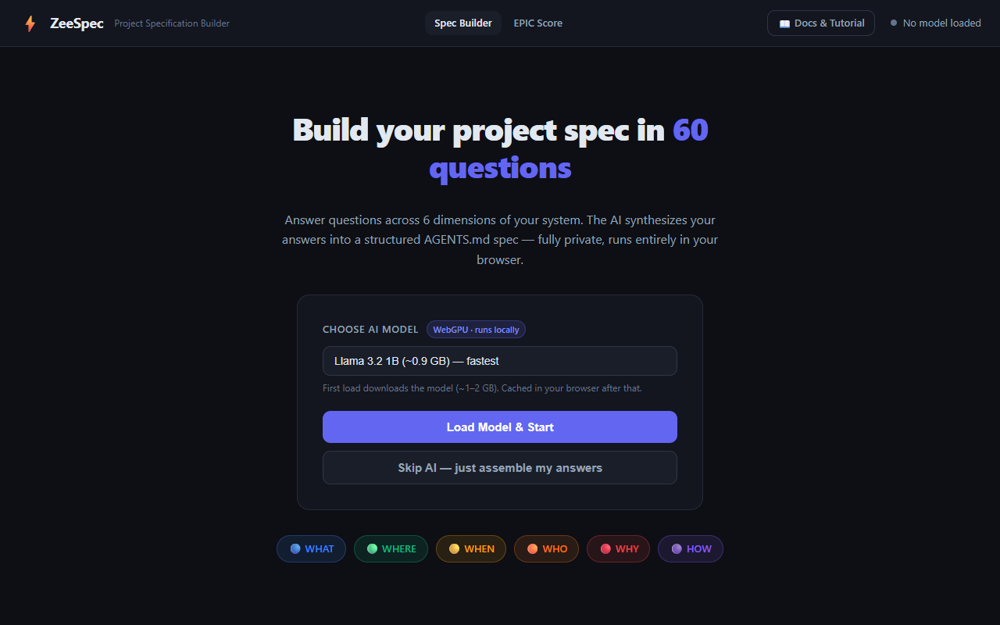

Answer the questions for each dimension. You don't need to load an AI model for this.

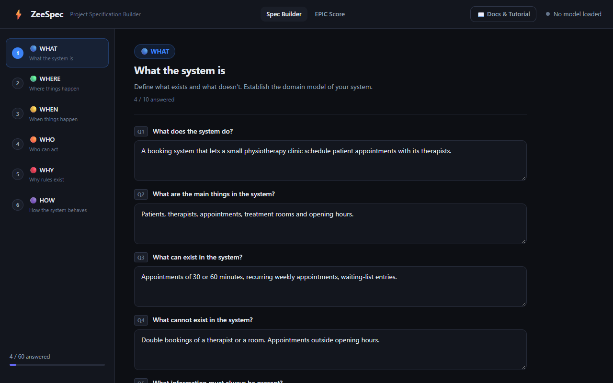

When you click **Generate Spec**, you get your AGENTS.md. The output screen now has a **Score with EPIC →** button.

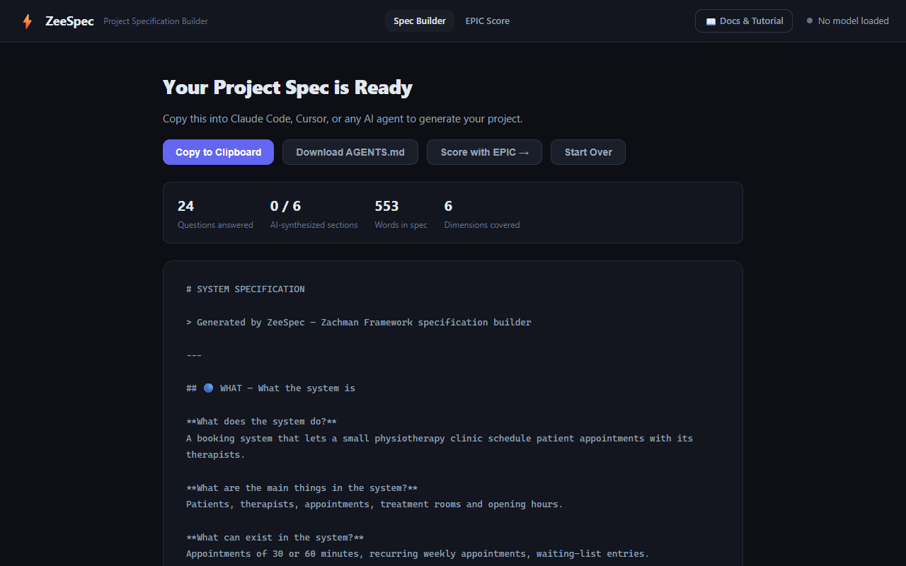

### 2. See the score

One click scores the spec you just built. Here is the result for a clinic booking spec: 24 questions answered in clear, specific sentences.

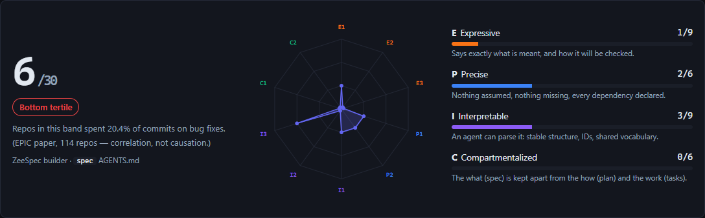

It scores **6 out of 30**, in the bottom band. That's the useful part. The answers are good, with real numbers such as "within 2 seconds", "24 hours before" and "retried 3 times", and a real exclusion: "Medical notes MUST NOT be sent". But the spec as a whole is missing what an agent needs. It has no requirement IDs, no acceptance criteria, no glossary, no open-questions list, and no plan or task list kept separate from the requirements. A person reading it would think it was fine. The score shows why an agent might not.

The radar shows the shape of the gaps at a glance, and the bars on the right total each of the four headings.

### 3. See exactly what is missing, with evidence

Below the score, every dimension lists its practices, each marked **✓ met**, **~ partial** or **✗ missing**. Where the scorer found evidence, it quotes the line it used, with the file name and line number. Every gap that isn't fully met comes with a one-line fix.

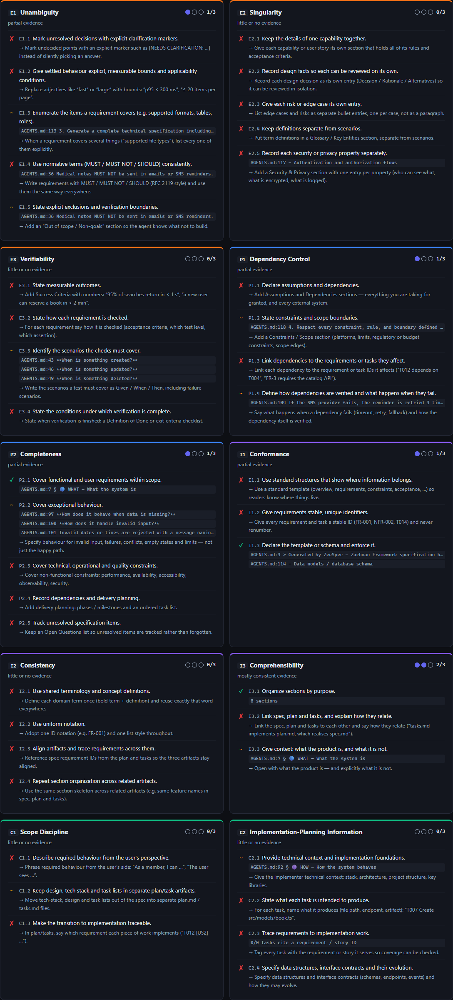

So instead of just "your spec is weak", you get a list of specific tasks: *add Success Criteria with numbers*, *give every requirement a stable ID (FR-001)*, *add an Out of scope section*, *say which requirement each task implements*.

### 4. Catch vague lines

The scorer also reads line by line for wording that can't be tested: words like "fast", "easily", "user-friendly", "etc.", "should be able to" and "might", and lines that start with a pronoun ("It should send notifications…"). Here it is on a deliberately weak sample:

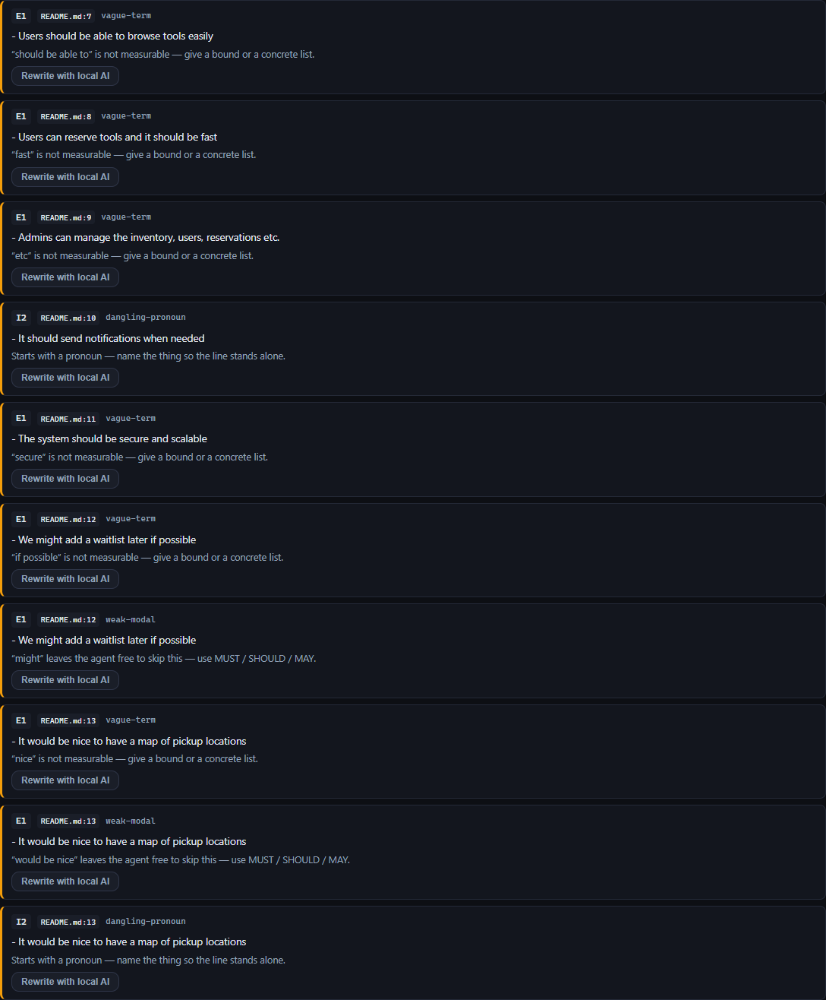

Each finding has a **Rewrite with local AI** button. An optional model runs on your own GPU through WebGPU and rewrites the line as a testable requirement. If the line needs a number the model doesn't know, it inserts `[NEEDS CLARIFICATION: …]` rather than making one up.

### 5. Fix it and share it

The last section turns the score into actions:

- **A README badge** that shows the score and links back to a live re-score of your repo.
- **A fix-it prompt** to paste into Claude Code, Cursor or Copilot. It lists the gaps, most severe first. It also tells the agent not to invent product facts and to mark what's missing with `[NEEDS CLARIFICATION]`.
- **A downloadable report** (`epic-report.md`) to put in a pull request or share with your team.

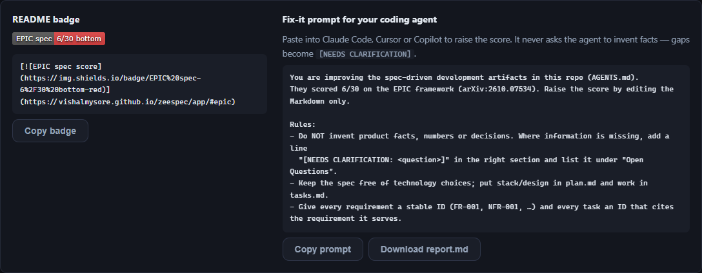

## It isn't only for ZeeSpec specs

The tab takes input from five sources: **From builder**, **GitHub repo**, **Paste**, **Upload files** and **Samples**.

### Any public GitHub repo

Type `owner/repo` or paste a GitHub folder URL. The tab finds spec-like files in all the common layouts: Spec Kit (`specs/*/spec.md`), Kiro (`.kiro/specs`), ZeeSpec (`.spec/*.md`), `AGENTS.md`, PRDs, plans and task lists. They're grouped by folder so you can pick one feature's set.

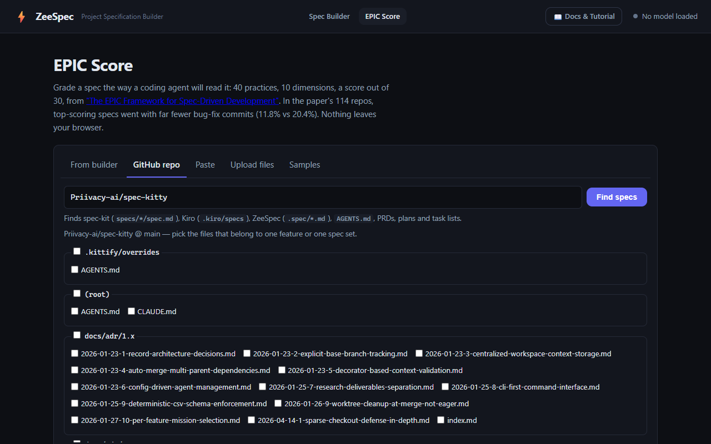

A spec, plan and task set from an open-source spec-driven project scores 22, at the top of the middle band:

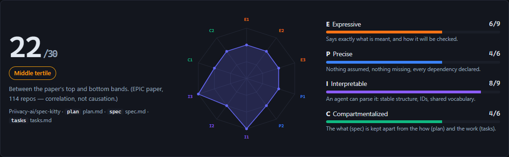

The badge link opens this exact view, so anyone who clicks the badge in your README sees the score worked out again from your current files.

### What "good" looks like

The **Samples** tab has the same small product written two ways. The vague one-file README scores **0/30**:

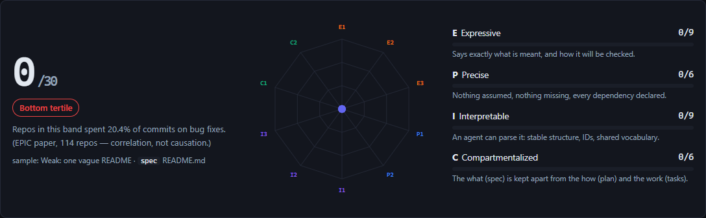

The full spec + plan + tasks set scores **29/30**:

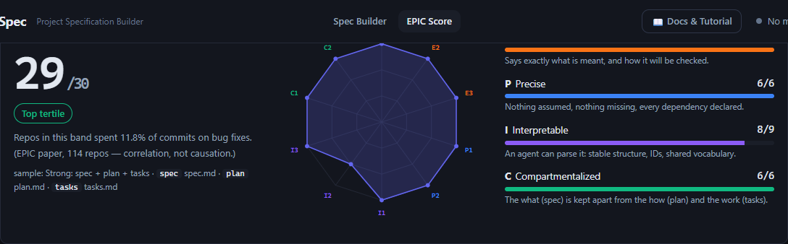

Putting the two side by side is the quickest way to see what the 40 practices ask for in practice.

### On a phone

The whole tab works at phone width, so you can check a repo's score from a link someone sent you.

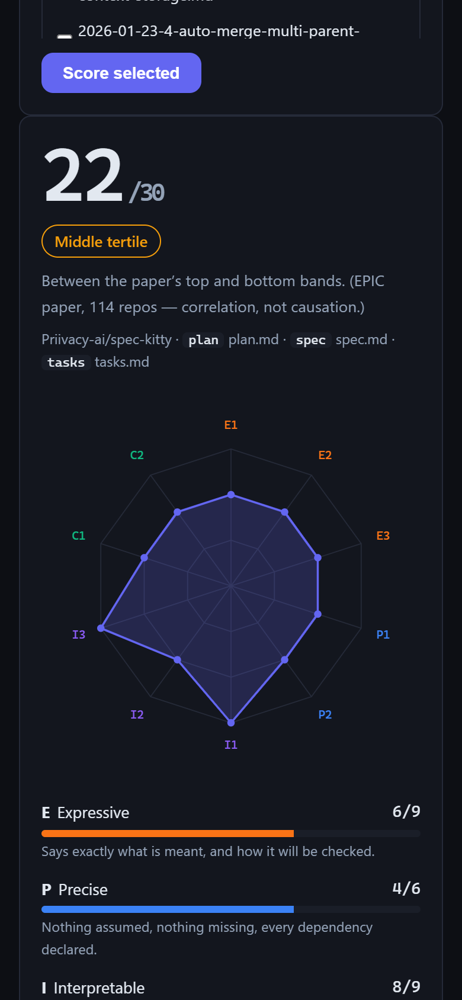

## In the terminal and in CI

The same scorer runs from the ZeeSpec command line:

```bash
spec score                      # scores .spec/ and AGENTS.md in the current folder
spec score specs/003-feature    # any folder or files
spec score specs/ --min 23      # exit code 2 below the top band
spec score --json               # machine-readable output
```

```text
EPIC score — specs/003-tool-reservations/spec.md [spec], …/plan.md [plan], …/tasks.md [tasks]

  E1  Unambiguity                          ●●●  3/3
        ◐ E1.3 When a requirement covers several things, list every one of them explicitly.
  E2  Singularity                          ●●●  3/3
  E3  Verifiability                        ●●●  3/3
  P1  Dependency Control                   ●●●  3/3
  P2  Completeness                         ●●●  3/3
  I1  Conformance                          ●●●  3/3
  I2  Consistency                          ●●○  2/3
        ◐ I2.3 Reference spec requirement IDs from the plan and tasks so the three artifacts stay aligned.
  I3  Comprehensibility                    ●●●  3/3
  C1  Scope Discipline                     ●●●  3/3
  C2  Implementation-Planning Information  ●●●  3/3

  Total: 29/30 — Top tertile   (34/40 practices fully met)
```

Add `spec score specs/ --min 23` to your CI pipeline, and a pull request that drops your specs out of the top band fails the build. That's the same check you already run on code with linting and tests.

## Why this is useful

- **It catches spec bugs before they become code bugs.** A missing acceptance criterion costs a minute to add to a spec. It costs much more to find later in a pull request, or in production.
- **It makes "good spec" concrete.** Teams argue about spec quality because nobody has written down what it means. EPIC gives you 40 named practices and a number you can track over time.
- **It points to the next edit.** Every gap comes with evidence and a one-line fix, and the fix-it prompt hands the whole list to your coding agent.
- **It keeps your work private.** Scoring runs in your browser or terminal. Nothing is uploaded, and the optional AI judge runs on your own GPU.
- **It works with what you already use.** Spec Kit, Kiro, ZeeSpec, a plain AGENTS.md or a PRD can all be scored without changing how you write.

## Limits

The scoring is a heuristic version of the paper's rubric, built from rules that look for evidence in the text. It is not the authors' own tool, and the practice wording is a paraphrase. The rules read English, so specs in other languages score unfairly low. The optional on-device judge re-reads each dimension against the paper's 0–3 rubric and is averaged with the rules, but it is only as good as the small model you load. And the paper's link between spec quality and fewer bug fixes is a correlation across 114 repos, not a promise for your project.

Used as a checklist rather than a verdict, it answers a practical question: *if I gave this spec to a coding agent today, where would it have to guess?*

---

**Try it:** [vishalmysore.github.io/zeespec/app/#epic](https://vishalmysore.github.io/zeespec/app/#epic) · **Source:** [github.com/vishalmysore/zeespec](https://github.com/vishalmysore/zeespec) · **Paper:** [The EPIC Framework for Spec-Driven Development (arXiv:2610.07534)](https://arxiv.org/abs/2610.07534)
