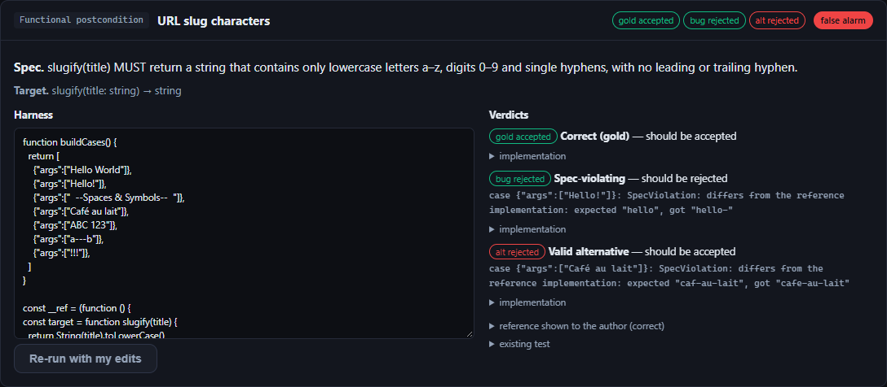
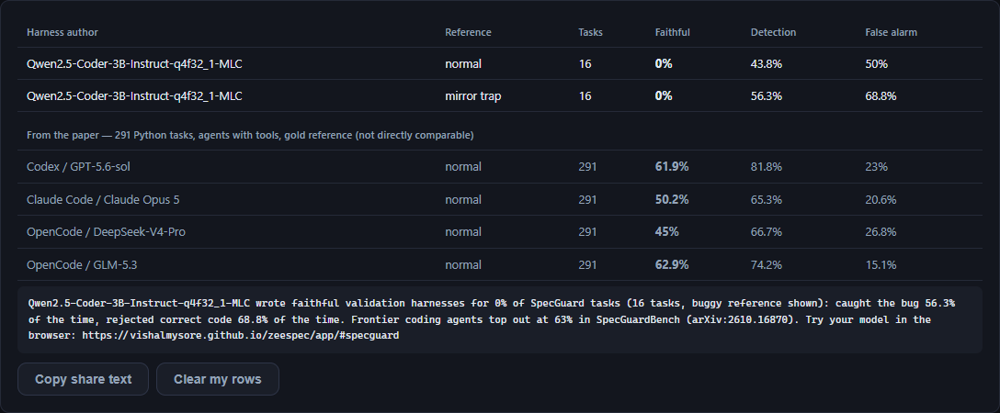

# SpecGuard: When AI Coding Agents Write Tests That Approve Bugs

*Ask a coding agent to write checks for a requirement and it will often copy what the existing code does instead. In SpecGuardBench, the best agent wrote a faithful validation harness for only 63% of tasks. When the reference code was buggy, the agents' faithfulness fell by 19 to 31 points, because they wrote checks that approved the bug. Here is a free, in-browser playground that shows the failure on small tasks, lets you edit a harness and watch it pass or fail, and lets you try small local models on the same test.*


## The problem: tests that agree with the code

Here is a one-line requirement:

> `slugify(title)` MUST return a string that contains only lowercase letters a–z, digits 0–9 and single hyphens, with no leading or trailing hyphen.

You give a coding agent this requirement, the current implementation and the existing test, and ask it for a validation harness: a set of checks that tells you whether an implementation meets the requirement.

The easy way out is to run the current implementation, record its outputs and assert that any other implementation returns exactly the same thing. That harness passes on the current code and looks thorough. It is also wrong in two ways:

1. **It approves whatever the reference does.** If the reference has a bug, the harness treats the bug as correct behaviour.
2. **It rejects valid code.** The requirement says nothing about accented letters. One correct implementation turns "Café au lait" into `caf-au-lait`, and another turns it into `cafe-au-lait`. Both meet the requirement. A harness that copies the reference fails the second one.

This matters more as agents write more of the code. The harness is what decides whether the agent's next change is accepted. If it checks the old code instead of the requirement, it blocks valid changes and lets real bugs through.

## What the research found

*SpecGuardBench: Can Coding Agents Construct Reliable Validation Harnesses from Natural Language Specifications?* (arXiv:2610.16870) tested this directly. The benchmark has 291 Python tasks covering eight kinds of verification logic. For each task there is a correct implementation, a buggy one that breaks the requirement but still passes the existing test, and valid alternatives that behave differently wherever the requirement says nothing.

A harness counts as **faithful** only if it rejects the bug **and** accepts every correct version.

| Coding agent (paper, 291 tasks) | Faithful | Catches the bug | Rejects correct code |
|---|---|---|---|
| OpenCode / GLM-5.3 | **62.9%** | 74.2% | 15.1% |
| Codex / GPT-5.6-sol | **61.9%** | 81.8% | 23.0% |
| Claude Code / Claude Opus 5 | **50.2%** | 65.3% | 20.6% |
| OpenCode / DeepSeek-V4-Pro | **45.0%** | 66.7% | 26.8% |

Then the authors set a trap. They showed the agents the **buggy** implementation as the reference. If an agent were really working from the requirement, the reference wouldn't matter. It mattered a lot:

| Agent (paper, 100-task Lite set) | Correct reference shown | Buggy reference shown |
|---|---|---|
| Codex | 65% | **46%** |
| OpenCode / GLM | 68% | **39%** |
| OpenCode / DeepSeek | 52% | **28%** |
| Claude Code | 52% | **21%** |

Faithfulness fell by 19 to 31 points. The agents trusted the code they were shown more than the requirement they were given.

## The solution: SpecGuard, a playground that runs in your browser

**SpecGuard** is a small, free re-creation of SpecGuardBench that runs entirely in a browser tab. Treat it as a hands-on way to see the failure and to practise writing faithful checks, not as a replacement for the paper's benchmark. It ships as a tab in [ZeeSpec](https://vishalmysore.github.io/zeespec/app/#specguard), an open-source spec builder for AI coding agents, next to the EPIC Score tab that grades the spec itself.

It has **16 JavaScript tasks**, two for each of the paper's eight types of verification logic:

| Type | What the check must establish |
|---|---|
| Functional postcondition | The return value satisfies a rule about the inputs. |
| Input validation | Certain inputs raise an error or give a specified result. |
| State postcondition | The state after the call relates to the state before it as required. |
| Frame condition | The call leaves specified state unchanged. |
| Interaction protocol | Other components are called with the right arguments, the right number of times. |
| Call order | Events within one run happen in the specified order. |
| Interface signature | The interface has the specified names, number of arguments or members. |
| Relational property | Two or more runs relate to each other as specified. |

Each task works like the paper's. The harness author sees the requirement, how to call the code, a reference implementation and the existing test. Kept hidden from the author are a correct implementation, a buggy one that passes the existing test, and a valid alternative.

You pick who writes the harnesses:

- **A local model.** It runs on your own GPU through WebGPU and is downloaded once. Nothing is sent to a server.
- **Three baselines that need no GPU**, which show how the scoring works.

Every harness runs in a separate background worker with no network access and a time limit of a few seconds, so model-written code can't do anything harmful or hang the page.

## One task, up close

Here is the whole slugify task. The harness author sees the requirement, the reference implementation and the existing test:

```js
// Spec: slugify(title) MUST return a string that contains only lowercase letters a–z,
// digits 0–9 and single hyphens, with no leading or trailing hyphen.

// Reference implementation (shown to the author)
const slugify = (title) => String(title).toLowerCase()
  .replace(/[^a-z0-9]+/g, '-')
  .replace(/^-+|-+$/g, '')

// Existing test (already passes)
assertEqual(slugify('Hello World'), 'hello-world')
```

Hidden from the author are a buggy version and a valid alternative:

```js
// Buggy: strips a leading hyphen but not a trailing one. Still passes the existing test.
const buggy = (title) => String(title).toLowerCase()
  .replace(/[^a-z0-9]+/g, '-')
  .replace(/^-+/, '')                      // 'Hello!' → 'hello-'  (breaks the spec)

// Valid alternative: transliterates accents instead of dropping them.
const alternative = (title) => String(title).normalize('NFD').replace(/[̀-ͯ]/g, '')
  .toLowerCase().split(/[^a-z0-9]+/).filter(Boolean).join('-')
                                           // 'Café au lait' → 'cafe-au-lait' (reference gives 'caf-au-lait')
```

A faithful harness checks the rule and nothing else, so it rejects the buggy version and accepts the other two:

```js
function checkCase(target, c) {
  const s = target(...c.args)
  assert(/^[a-z0-9]+(-[a-z0-9]+)*$/.test(s) || s === '', 'only a–z, 0–9 and single inner hyphens')
}
```

A harness that copies the reference (`assertEqual(target(x), reference(x))`) rejects the bug too. But it also rejects the valid alternative, because `cafe-au-lait` isn't what the reference returned, even though the spec never mentions accents. In the app you can open any task, see each verdict and the reason for it, edit the harness and click **Re-run with my edits**:



## What the baselines show

Three baselines need no model and show that the scoring works:

| Baseline (16 tasks) | Faithful | Catches the bug | Rejects correct code |
|---|---|---|---|
| Hand-written oracle: checks only what the spec says | **100%** | 100% | 0% |
| Mirror the reference: "behave exactly like the reference" | **0%** | 100% | 100% |
| Mirror the reference, with the **buggy** reference shown | **0%** | 0% | 100% |
| Replay the existing test | **0%** | 0% | 0% |

- **The oracle** confirms every task can be solved and the scoring recognises a correct answer.
- **Mirroring** catches every bug, which looks good, but rejects every valid alternative. Show it the buggy reference and it catches nothing, because the bug is what it copied. A harness that copies the code can never be better than the code.
- **Replaying the existing test** catches nothing, because by design every buggy version passes it. "The tests pass" proves nothing here.

## A small model, as a demonstration

What happens when a model writes the harness itself? I ran **Qwen 2.5 Coder 3B**, a small code-tuned model, through all 16 tasks in the browser on a laptop's built-in Intel graphics chip. One run took about 25 minutes. This is a demonstration of the failure, not a benchmark score. A 3B model writing code in one attempt, with no chance to run it and fix mistakes, isn't comparable to the paper's frontier agents, which can execute code and iterate.

| Qwen 2.5 Coder 3B, 16 tasks | Harness didn't run | Ran | Faithful | Rejected correct code | Accepted the bug |
|---|---|---|---|---|---|
| Correct reference shown | 6 | 10 | **0** | 8 | 3 |
| Buggy reference shown (mirror trap) | 3 | 13 | **0** | 11 | 4 |

Six harnesses failing to run measures the model's one-shot JavaScript, not its reading of the spec. The other 10 are the interesting part, and not one of them was faithful. Eight rejected correct code, and the other two accepted everything, bug included.

The model's slugify harness shows the most common failure:

```js
// Written by Qwen 2.5 Coder 3B
assert(/^[a-z0-9]+$/.test(result), 'Result must contain only lowercase letters and digits')
```

The spec allows single hyphens, and the model dropped that clause. So the harness rejects the bug, but it also rejects the correct implementation and the valid alternative, because `hello-world` contains a hyphen. That isn't copying the reference. It's misreading the spec, and it produces the same result: a check that fails good code.


The mirror trap produced one case with the paper's pattern. On the top-k task, the model's harness accepted all three versions when it was shown the correct reference. Shown the buggy reference, it accepted the bug and rejected both correct versions, exactly what you'd expect from a harness that trusts the code it was shown. With overall faithfulness already at 0%, though, the trap can't show a drop, and on 16 tasks the other numbers move by several points from run to run.

Llama 3.2 1B, the smallest model on offer, couldn't take part. It wrote test-framework code (`describe`, `it`) instead of the harness it was asked for, and 15 of its 16 harnesses didn't run.

## Try it yourself

Start small. In **Tasks**, pick one type (two tasks). With the hand-written oracle or the mirror baseline it finishes instantly. With a local model it takes a few minutes. Open a task, read each verdict, change the harness and click **Re-run with my edits**: that loop is the quickest way to get a feel for what "faithful" means.

To try a model on all 16 tasks, choose **Local model**, pick one and click **Run benchmark**, then run it again with the mirror trap on. Allow 20–30 minutes per run on a laptop GPU. Each run adds a row to a leaderboard kept in your browser. The paper's results sit below it for reference and are labelled as not directly comparable.



## The takeaway

Whether a person or an agent writes the tests, apply one rule when you review them: **for every assertion, point to the sentence in the spec that requires it.** If you can't, the assertion is checking the current code, not the requirement. Delete it, or add the missing sentence to the spec. In SpecGuard, both mirroring and the small model's over-strict checks fail that rule.

It works in the other direction too. If a sentence in the spec has no assertion, the harness can't catch a bug there. That's the gap the buggy implementations in these tasks slip through.

## Limits

SpecGuard is a small re-creation, not the benchmark itself. It has 16 hand-built JavaScript tasks against the paper's 291 Python ones. Its harness authors are single local models writing code in one attempt, with no retry. A harness that fails to run counts as unfaithful, and the app reports those separately. No frontier model has been run on these 16 tasks, so there's no direct calibration of how hard they are compared with the paper's. The task set itself is checked automatically: every hidden implementation is confirmed to behave as intended, and the hand-written oracle scores 100%.

---

*Disclaimer: this article is my own interpretation of the SpecGuardBench paper. SpecGuard is an independent, simplified re-creation, not the authors' benchmark or code. The tasks, baselines and scoring are my reading of their method, and any errors are mine. For the authors' exact method and results, see the paper.*

**Try it:** [vishalmysore.github.io/zeespec/app/#specguard](https://vishalmysore.github.io/zeespec/app/#specguard) · **Source:** [github.com/vishalmysore/zeespec](https://github.com/vishalmysore/zeespec) · **Paper:** [SpecGuardBench (arXiv:2610.16870)](https://arxiv.org/abs/2610.16870) · **Companion:** [How Bad Is Your Spec? Scoring Specs for AI Coding Agents](https://github.com/vishalmysore/zeespec/blob/main/docs/epic/epic-score-article.md)
