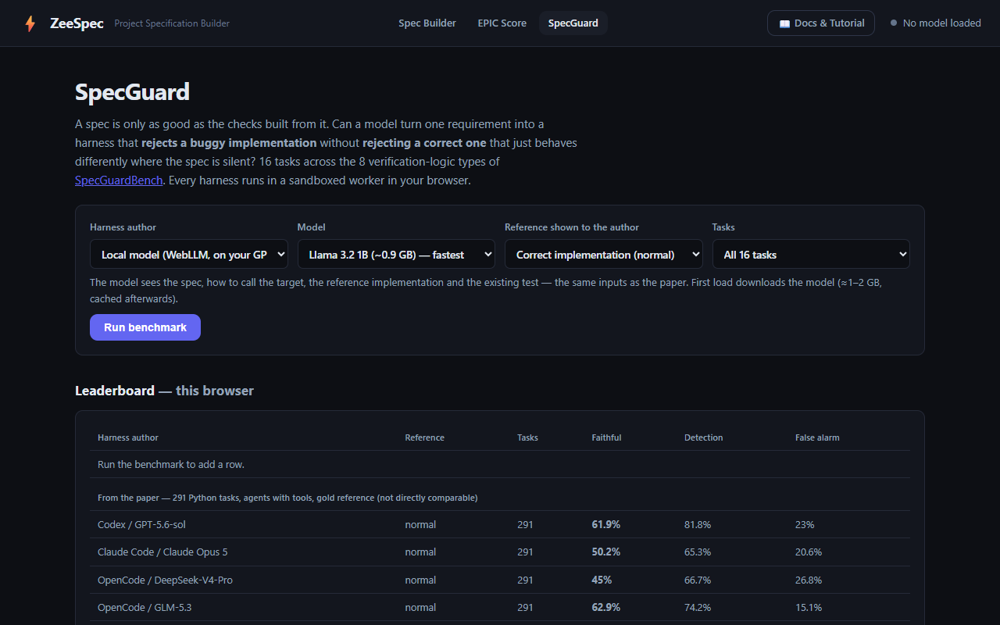
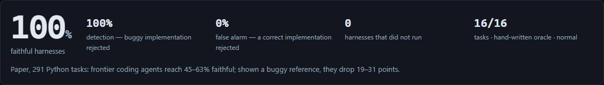
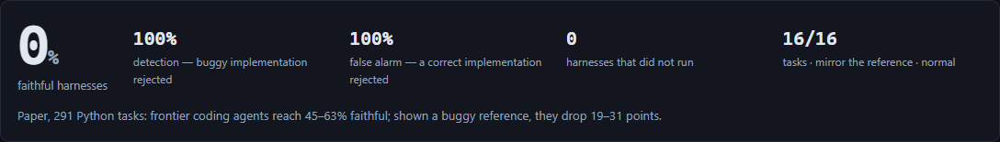
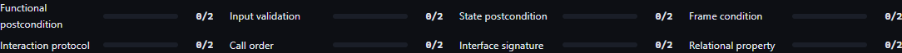
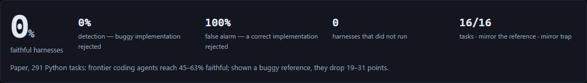
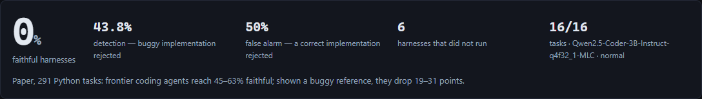
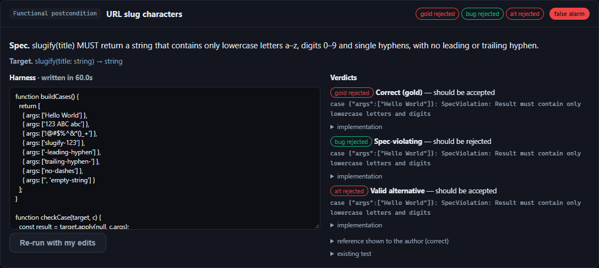
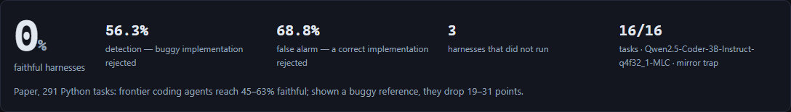
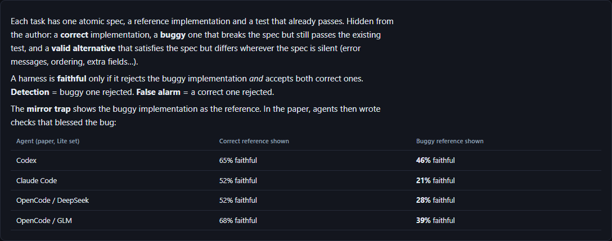

# SpecGuard: When AI Coding Agents Write Tests That Approve Bugs

*Ask a coding agent to write checks for a requirement and it will often copy what the existing code does instead. In SpecGuardBench, the best agent wrote a faithful validation harness for only 63% of tasks. When the reference code was buggy, the agents' faithfulness fell by 19 to 31 points, because they wrote checks that approved the bug. A 3-billion-parameter coding model running on a laptop's built-in graphics chip scored 0% on the same test. Here is a free, in-browser way to test any model for this.*

## The problem: tests that agree with the code

Here is a one-line requirement:

> `slugify(title)` MUST return a string that contains only lowercase letters a–z, digits 0–9 and single hyphens, with no leading or trailing hyphen.

You give a coding agent this requirement, the current implementation and the existing test, and ask it for a validation harness: a set of checks that tells you whether an implementation meets the requirement.

The easy way out is to run the current implementation, record its outputs and assert that any other implementation returns exactly the same thing. That harness passes on the current code and looks thorough. It is also wrong in two ways:

1. **It approves whatever the reference does.** If the reference has a bug, the harness treats the bug as correct behaviour.
2. **It rejects valid code.** The requirement says nothing about accented letters. One correct implementation turns "Café au lait" into `caf-au-lait`, and another turns it into `cafe-au-lait`. Both meet the requirement. A harness that copies the reference fails the second one.

This matters more as agents write more of the code. The harness is what decides whether the agent's next change is accepted. If it checks the old code instead of the requirement, it blocks valid changes and lets real bugs through.

## What the research found

*SpecGuardBench: Can Coding Agents Construct Reliable Validation Harnesses from Natural Language Specifications?* (arXiv:2610.16870) tested this directly. The benchmark has 291 Python tasks covering eight kinds of verification logic. For each task there is a correct implementation, a buggy one that breaks the requirement but still passes the existing test, and valid alternatives that behave differently wherever the requirement says nothing.

A harness counts as **faithful** only if it rejects the bug **and** accepts every correct version.

| Coding agent (paper, 291 tasks) | Faithful | Catches the bug | Rejects correct code |
|---|---|---|---|
| OpenCode / GLM-5.3 | **62.9%** | 74.2% | 15.1% |
| Codex / GPT-5.6-sol | **61.9%** | 81.8% | 23.0% |
| Claude Code / Claude Opus 5 | **50.2%** | 65.3% | 20.6% |
| OpenCode / DeepSeek-V4-Pro | **45.0%** | 66.7% | 26.8% |

Then the authors set a trap. They showed the agents the **buggy** implementation as the reference. If an agent were really working from the requirement, the reference wouldn't matter. It mattered a lot:

| Agent (paper, 100-task Lite set) | Correct reference shown | Buggy reference shown |
|---|---|---|
| Codex | 65% | **46%** |
| OpenCode / GLM | 68% | **39%** |
| OpenCode / DeepSeek | 52% | **28%** |
| Claude Code | 52% | **21%** |

Faithfulness fell by 19 to 31 points. The agents trusted the code they were shown more than the requirement they were given.

## The solution: SpecGuard, a benchmark that runs in your browser

**SpecGuard** is a small, free re-creation of SpecGuardBench that runs entirely in a browser tab. It ships as a tab in [ZeeSpec](https://vishalmysore.github.io/zeespec/app/#specguard), an open-source spec builder for AI coding agents, next to the EPIC Score tab that grades the spec itself.

It has **16 JavaScript tasks**, two for each of the paper's eight types of verification logic:

| Type | What the check must establish |
|---|---|
| Functional postcondition | The return value satisfies a rule about the inputs. |
| Input validation | Certain inputs raise an error or give a specified result. |
| State postcondition | The state after the call relates to the state before it as required. |
| Frame condition | The call leaves specified state unchanged. |
| Interaction protocol | Other components are called with the right arguments, the right number of times. |
| Call order | Events within one run happen in the specified order. |
| Interface signature | The interface has the specified names, number of arguments or members. |
| Relational property | Two or more runs relate to each other as specified. |

Each task works like the paper's. The harness author sees the requirement, how to call the code, a reference implementation and the existing test. Kept hidden from the author are a correct implementation, a buggy one that passes the existing test, and a valid alternative.

You pick who writes the harnesses:

- **A local model.** It runs on your own GPU through WebGPU and is downloaded once. Nothing is sent to a server.
- **Three baselines that need no GPU**, which show how the scoring works.

Every harness runs in a separate background worker with no network access and a time limit of a few seconds, so model-written code can't do anything harmful or hang the page.

## What the baselines show

### The hand-written oracle: 100%

A harness that checks only what the requirement says is faithful on all 16 tasks. This confirms that every task can be solved: each one has a correct answer, and the scoring recognises it.

### "Mirror the reference": 0%

This baseline does the easy thing described above: it asserts that the code behaves exactly like the reference. It catches **every** bug, which looks good. But it also rejects **every** valid alternative, so not one of its harnesses is faithful.

The breakdown by type shows the same pattern in all eight categories:

Open any task to see why. Here is the slugify task. The copied harness correctly rejects the bug (`"Hello!"` becomes `hello-`, with a trailing hyphen). It also rejects the valid alternative, because `cafe-au-lait` isn't what the reference returned, even though the requirement never mentions accents.

The harness is editable. You can fix it, click **Re-run with my edits** and watch the false alarm disappear.

### The mirror trap: the bug becomes the rule

Switch "Reference shown to the author" to **Buggy implementation (mirror trap)** and run the same baseline. Now it catches **0%** of the bugs, because the bug is what it copied, and it still rejects every correct implementation. This is the paper's trap experiment in its most extreme form: a harness that copies the code can never be better than the code.

### Replaying the existing test: 0%

The last baseline shows why "the tests pass" proves nothing here. By design, every buggy implementation passes the existing test, so re-running it catches nothing.

## What a real model does

Baselines show the scoring works. The real question is what a model does when it writes the harness itself. I ran **Qwen 2.5 Coder 3B**, a code-tuned model, through all 16 tasks on a laptop's built-in Intel graphics chip, entirely in the browser. Each harness took about one to five minutes to write.

| Qwen 2.5 Coder 3B (16 tasks) | Faithful | Catches the bug | Rejects correct code | Harness didn't run |
|---|---|---|---|---|
| Correct reference shown | **0%** | 43.8% | 50.0% | 6 of 16 |
| Buggy reference shown (mirror trap) | **0%** | 56.3% | 68.8% | 3 of 16 |

**Not one faithful harness.** And look at how it fails. With the correct reference shown, every bug it caught came with a rejected correct implementation. It never once checked the requirement and only the requirement.

The slugify task shows why. The model wrote a reasonable-looking harness, then asserted that the result must contain *only lowercase letters and digits*. The spec says hyphens are allowed; the model dropped that clause. So its harness rejects the bug, but it also rejects the correct implementation and the valid alternative, because `hello-world` contains a hyphen.

The other failures fall into three groups:

- **Inventing rules.** On the top-k task it made up a behaviour for a negative `k` that the spec never states, then failed every implementation that didn't match its guess.
- **Checking too little.** On two tasks the harness accepted everything, the bug included.
- **Code that doesn't run.** Six harnesses crashed before checking anything at all.

With the buggy reference shown, the result was still 0% faithful:

The trap can't show a drop when there is nothing to drop from. The detection and false-alarm rates moved in both directions between the two runs, which on 16 tasks is within normal run-to-run variation. The finding is simpler: at this size, the model doesn't separate *what the spec requires* from *what the code it was shown happens to do*.

The smallest model on offer, Llama 3.2 1B, couldn't take part at all. It wrote test-framework code (`describe`, `it`) instead of the harness it was asked for, and 15 of its 16 harnesses failed to run.

## Put your model on the leaderboard

Choose **Local model**, pick a model and click **Run benchmark**. Each run adds a row to a leaderboard kept in your browser, shown next to the paper's results for comparison. Then run it again with the mirror trap switched on. The gap between the two runs shows how much your model relies on the reference code instead of the requirement.

**Copy share text** gives you a one-line summary of your result to post.

The page also explains how scoring works and repeats the paper's trap results, so anyone you share it with can check the method:

## Why this is useful

- **It tests the right skill.** Most coding benchmarks ask whether an agent can write code that passes tests. This one asks whether it can write tests that judge code correctly, which is the skill that keeps agent-written code honest.
- **It makes a quiet failure visible.** A harness copied from the code looks thorough and passes on day one. The cost shows up later, as blocked valid changes and approved bugs. The mirror trap shows that cost in seconds.
- **It gives you a better instruction for your agents.** If the requirement doesn't say it, don't assert it. Check error messages, ordering and extra fields only when the spec asks for them.
- **It's private and free.** Everything runs in your browser. Models run on your own GPU, and harnesses run in a sandbox with no network access.
- **It pairs with spec scoring.** EPIC Score, in the next tab, checks whether a spec is clear enough to build from. SpecGuard checks whether a model can turn a requirement into checks without copying the code. Vague specs leave room for copying, and precise ones make copying easy to spot.

## Limits

SpecGuard is a small re-creation, not the benchmark itself. It has 16 hand-built JavaScript tasks against the paper's 291 Python ones, and its harness authors are single local models rather than agents that can run tools. The browser models are also far smaller than the frontier agents in the paper, so a 0% here measures a 3B model in one attempt per task, not what coding agents in general can do. With only 16 tasks, results move by several points from one run to the next. Its scores are not directly comparable with the paper's numbers, and the leaderboard labels them that way. The task set is checked automatically: every hidden implementation is confirmed to behave as intended, and the hand-written oracle scores 100%.

---

*Disclaimer: this article is my own interpretation of the SpecGuardBench paper. SpecGuard is an independent, simplified re-creation, not the authors' benchmark or code. The tasks, baselines and scoring are my reading of their method, and any errors are mine. For the authors' exact method and results, see the paper.*

**Try it:** [vishalmysore.github.io/zeespec/app/#specguard](https://vishalmysore.github.io/zeespec/app/#specguard) · **Source:** [github.com/vishalmysore/zeespec](https://github.com/vishalmysore/zeespec) · **Paper:** [SpecGuardBench (arXiv:2610.16870)](https://arxiv.org/abs/2610.16870) · **Companion:** [How Bad Is Your Spec? Scoring Specs for AI Coding Agents](https://github.com/vishalmysore/zeespec/blob/main/docs/epic/epic-score-article.md)
